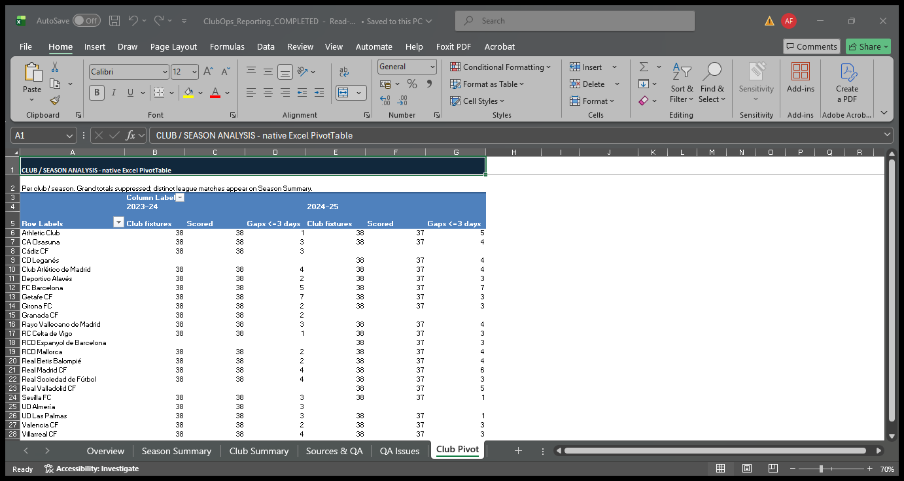
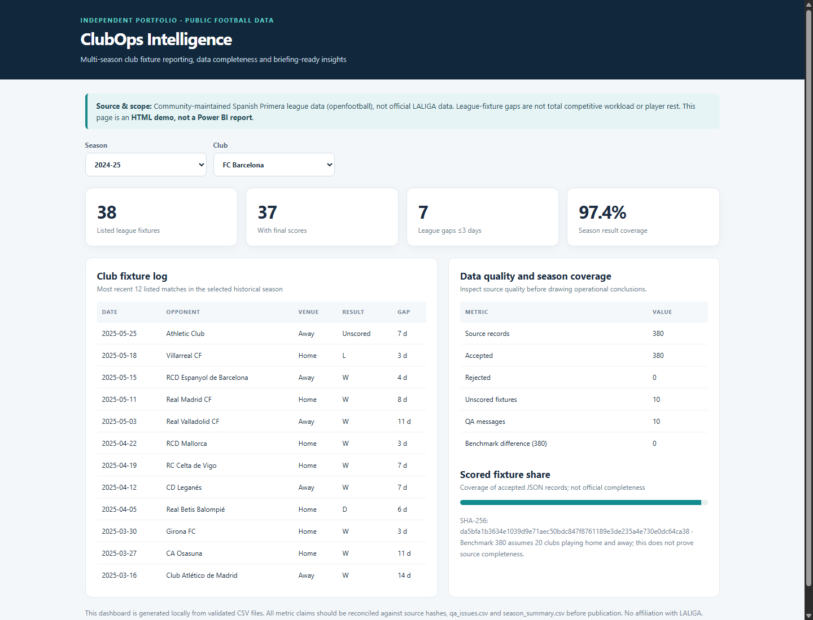
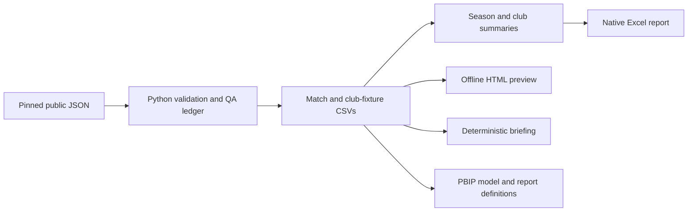

# ClubOps Intelligence

**[Live portfolio & dashboard](https://mrtrauf.github.io/clubops-intelligence-public/)** ? [Open interactive dashboard](https://mrtrauf.github.io/clubops-intelligence-public/dashboard/)

### League fixture reporting with visible data quality

Independent football data and business intelligence portfolio. **No affiliation
with, endorsement by, or internal data access from LALIGA or any club.**

A simulated Club Office analyst needs consistent multi-season reporting: which
league calendars contain short gaps, how clubs compare, and whether the source
is complete enough to support a meeting briefing. ClubOps turns public fixtures
into traceable CSVs, a native Excel report and an offline HTML preview.

## Real results

| Season | Source / accepted fixtures | Scored | Unknown results | Clubs |
|---|---:|---:|---:|---:|
| 2023-24 | 380 / 380 | 380 | 0 | 20 |
| 2024-25 | 380 / 380 | 370 | 10 | 20 |

**760 matches, 1,520 club-fixture rows and 40 club-season summaries.** No source
records were rejected in these snapshots. Ten empty score objects in 2024-25
Matchday 38 remain unknown and produce ten QA warnings: result coverage is
97.37%, even though fixture counts meet the 380-match benchmark.

Barcelona has **five league gaps <=3 days in 2023-24 and seven in 2024-25**.
This identifies calendar dates for further review, not evidence of player fatigue
or total competitive workload. [Definitions and limits](docs/KPIS_AND_LIMITATIONS.md).

## See the deliverables

| Deliverable | Verified status |
|---|---|
| [Python pipeline](clubops/pipeline.py) and [tests](tests/) | 19 tests pass with site packages disabled and under optimization; explicit row/summary validation |
| [Reporting CSVs](data/processed/) | Every accepted fixture and all 40 club-season summaries reconciled to raw records |
| [Excel workbook](https://mrtrauf.github.io/clubops-intelligence-public/downloads/ClubOps_Reporting.xlsx) | Native tables, SUM/SUMIFS formulas and a real PivotTable; 120 pivot values checked in Excel 16.0 |
| [Hosted HTML dashboard](https://mrtrauf.github.io/clubops-intelligence-public/dashboard/) | Reuses the verified HTML dashboard; not Power BI |
| [Traceable briefing](artifacts/briefing.md) | Deterministic, source-row/ID/hash references; future scores hidden |
| [Power BI Project](powerbi/ClubOps/ClubOps.pbip) | TMDL model, Power Query partitions and three PBIR pages authored; **static validation only, Desktop acceptance pending** |

The live GitHub Pages site provides the visitor experience, dashboard controls,
case study and briefing without authentication or installation. Excel and reporting
CSVs are optional public downloads. This static site is not a live data service.





These are existing genuine application captures. No Power BI screenshot is claimed.

## Architecture



Fixtures have two club perspectives. Unknown results count as fixtures but never
wins/draws/losses. Calendar gaps reset by club and season. Duplicate ordered
pairings and colliding club keys are rejected with a source-row audit trail;
required validation remains active under `python -O`.

## Website hosting

The GitHub Actions workflow in `.github/workflows/pages.yml` packages only `site/`
for GitHub Pages. `python scripts/prepare_site.py` copies existing verified assets
and renders the case study/briefing; it never rebuilds analytics.
`python scripts/check_site.py` checks relative navigation, public-link policy,
landing KPIs and unchanged embedded dashboard data. Browser checks use installed
Chrome: `node --experimental-websocket scripts/check_site_browser.mjs`.
The Pages deployment succeeded. Anonymous live checks passed for 18 HTTPS URLs;
Chrome verified desktop/mobile rendering, five club/season selections and no
console errors. See [website verification](docs/WEBSITE.md) for evidence and limits.

## Reproduce

Clone this repository and run from its root. The core CLI uses only Python's
standard library; this snapshot was tested on Windows with Python 3.12.10.
Pinned raw files and derived outputs are included for offline use.

```powershell
git clone https://github.com/MRTRauf/clubops-intelligence-public.git
cd clubops-intelligence-public
python -S -m unittest discover -s tests -v
python -O -m unittest discover -s tests -v
python -m clubops check
```

To deliberately regenerate the CSVs, briefing and HTML:

```powershell
python -m clubops fetch
python -m clubops build
python -m clubops check
python -m clubops brief --season 2024-25 --club "FC Barcelona" --as-of 2025-03-01 --days 30
python -m clubops html
python scripts/validate_outputs.py
```

`fetch` checks existing snapshots or downloads exact commit-pinned URLs when
missing. A configured hash mismatch stops processing; no alternate dataset is
silently substituted. The independent raw validator targets these two audited
seasons and must be reviewed when expanding scope.

Optional Excel regeneration requires Windows Excel and the reporting dependency:

```powershell
python -m pip install -r requirements-reporting.txt
python scripts/build_excel.py
powershell -NoProfile -File scripts/complete_excel.ps1
```

This overwrites the generated workbook; preserve custom edits first. The Python
step populates tables; the native Excel step creates, calculates and checks the
PivotTable. [Excel guide](docs/EXCEL_SETUP.md).

### Power BI status and setup

The [PBIP guide](powerbi/ClubOps/README.md) covers the seven-table model,
14 DAX definitions, seven relationships, three pages and 23 bound visuals.
Set the `DataFolder` placeholder to your local CSV directory before opening
in Desktop. The validator uses the repository CSVs independently of that setup:

```powershell
python -m pip install -r requirements-powerbi.txt
python scripts/validate_pbip.py --data-dir data/processed
```

All 32 schema-bearing files pass ten cached official Microsoft schemas. Static
checks cover field references, keys, relationship paths and CSV contracts.
**TMDL engine parsing, M/DAX execution, refresh, rendering and interactions have
not been verified in Desktop.** No PBIX, implemented Power Automate flow or LLM
feature is claimed. The briefing is rules-based.

## Data, validation and limitations

Data: [openfootball/football.json](https://github.com/openfootball/football.json),
community-maintained Spanish Primera records. The upstream CC0 dedication and
original README are retained with [exact URLs, hashes and provenance](data/provenance/manifest.json).
The files are pinned to commit `e6744429ee395bc86f247348c6184bb08d4eb361`.
[Source audit and reuse notes](docs/DATA_SOURCE_AND_RIGHTS.md).
Code is MIT-licensed; vendored Microsoft schemas retain their
[MIT license and attribution](powerbi/ClubOps/schemas/NOTICE.md).

[Validation evidence](docs/VALIDATION.md) separates checks rerun for this public
snapshot from earlier application verification. Read the [case study](docs/DEMO_AND_CASE_STUDY.md)
and [90-second demo script](docs/VIDEO_DEMO_SCRIPT.md) for the business narrative.

- Ten 2024-25 results are unknown; no official cross-source result audit was performed.
- League date gaps are not physical rest, cup/European workload or causal performance evidence.
- Historical briefings reconstruct a downloaded file, not a schedule archived at the cutoff.
- No attendance, financial, confidential operations or measured business-impact data is included.
- Additional-season acceptance and cross-machine Excel checks remain pending. Live hosted dropdown events were verified in Chrome.
- The next useful improvements are Desktop acceptance, an external review and a separately audited additional season; none is represented as completed.
